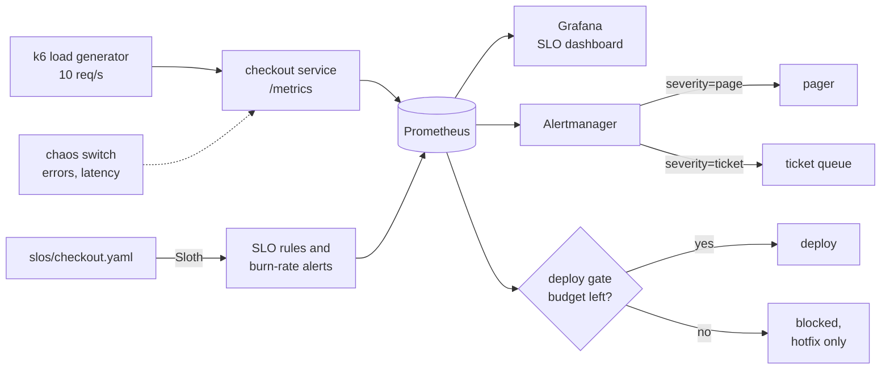

# Burn Rate

**SLOs, burn-rate alerts, and an error-budget deploy gate on Kubernetes.**

Teams argue about whether a service is "reliable enough" without numbers to settle it. Burn Rate runs a
small checkout service the way an SRE team runs production: it sets a reliability target (an SLO), tracks
how much failure that target allows (the error budget), pages someone when the budget burns too fast, and
blocks feature deploys once the budget is gone.

## The targets

| SLO | Target | Window | Error budget |
|---|---|---|---|
| Availability: checkout requests that succeed | 99.5% | 30 days | 0.5% of requests, about 3.6 hours of full outage |
| Latency: checkout requests faster than 300 ms | 95% | 30 days | 5% of requests may be slower |

## How it fits together



## Roadmap

- [x] **1. Checkout service with metrics and a chaos switch**
- [x] **2. Local Kubernetes (kind) with Prometheus and Grafana, plus steady k6 traffic**
- [x] **3. SLOs as code and multi-window burn-rate alerts**
- [x] **4. Grafana SLO dashboard: budget left, burn rate, time to exhaustion**
- [x] **5. Error-budget deploy gate, with a hotfix override**
- [x] **6. Game day: break it on purpose, watch the alerts and the gate, write the postmortem** (the drill runs in CI; the first written postmortem is next)

## SLOs as code and burn-rate alerts

The SLOs live in one file, [`slos/checkout.yaml`](slos/checkout.yaml). [Sloth](https://sloth.dev)
turns it into 30 Prometheus recording rules and 4 alerts, which deploy with everything else.

| Alert | Fires when | Severity |
|---|---|---|
| `CheckoutAvailabilityBudgetBurn` | Failures burn the 0.5% budget 14.4x too fast (1 h and 5 min windows) or 6x (6 h and 30 min) | page |
| | Failures burn it 3x too fast (1 day and 2 h) or 1x (3 days and 6 h) | ticket |
| `CheckoutLatencyBudgetBurn` | Same windows, for checkouts slower than 300 ms against the 5% budget | page or ticket |

Every alert links to a runbook: [availability](docs/runbooks/checkout-availability.md),
[latency](docs/runbooks/checkout-latency.md). The reasoning behind the numbers is in
[docs/slos.md](docs/slos.md).

**The alerts are tested like code.** promtool replays fake traffic with 3 days of history and checks
exactly what fires: a healthy service stays quiet, a full outage pages at 8 minutes, a 2% leak opens
a ticket after 20 hours but never pages, and a slowdown pages on latency only.

```bash
scripts/test-slo-rules.sh       # alert unit tests, no cluster needed
scripts/generate-slo-rules.sh   # after editing slos/checkout.yaml
scripts/test-alert-routing.sh   # where each alert lands
```

These need `promtool`, `amtool`, and `yq` (`brew install prometheus alertmanager yq`), and Sloth for regenerating
(download `sloth-darwin-arm64` from the [Sloth releases](https://github.com/slok/sloth/releases),
rename it to `sloth`, and put it on your PATH).

**See an alert fire for real** on the running lab:

```bash
scripts/chaos.sh 1 0                                            # every checkout fails
scripts/check-alert.sh CheckoutAvailabilityBudgetBurn page      # waits for the page
scripts/chaos.sh 0 0                                            # recover
```

Then open Alertmanager with `kubectl -n monitoring port-forward svc/kps-alertmanager 9093` to see it.

## Dashboard

Grafana loads **Checkout SLOs and error budget** automatically (Dashboards, then search "Checkout").

| Panel | Answers |
|---|---|
| Budget left (per SLO) | How much of this month's error budget is still unspent? |
| Burn rate (per SLO) | How fast is it being spent right now? 1 = exactly on budget, 14.4 = gone in 2 days |
| Budget gone in (per SLO) | At this pace, when does it run out? |
| Error ratio, burn rate over time | When did it start, and how close to the alert lines? |
| Requests by status, p50 and p95 latency | What users actually saw |
| Firing SLO alerts | What is paging right now |

The dashboard is tested too: every panel query must use a rule Sloth records or a metric the app
exports, and must parse in promtool, so a renamed rule cannot leave a panel quietly empty.

## Alert routing

Alertmanager sends `severity=page` to a **pager** receiver (reminds every hour) and
`severity=ticket` to a **ticket** queue (once a day). While an SLO is paging, its ticket is held
back, so one outage means one notification. The receivers are empty in the lab; add Slack,
PagerDuty, or email in `deploy/monitoring-values.yaml` for real notifications.
`scripts/test-alert-routing.sh` checks the routes with amtool.

## The deploy gate

Before a feature deploy, the gate asks Prometheus how much error budget is left:

```bash
scripts/gate.sh                                 # deploy or block
scripts/gate.sh --hotfix "Roll back release 1.4"   # a fix, recorded
```

| Situation | Exit code | Result |
|---|---|---|
| Every SLO has budget left | 0 | Deploy |
| Some SLO has under 25% left | 0 | Deploy, with a warning (and a yellow annotation in GitHub Actions) |
| Any SLO's budget is used up | 1 | Blocked, naming the SLO |
| No data, or Prometheus unreachable | 2 | Blocked: the gate fails closed |
| Blocked, but it is the fix | 0 | `--hotfix "reason"` lets it through and records who and why |

It prints a Markdown report and adds it to the GitHub Actions job summary. Add `--json` for a
machine-readable answer, for example to feed a chat bot or another pipeline step:

```bash
scripts/gate.sh --json | jq -r .decision        # allow, block, or unknown
```

## Game day

`scripts/game-day.sh` rehearses an outage on the running lab and prints a timeline for the
postmortem:

1. The gate allows a deploy while checkout is healthy.
2. Every checkout starts failing.
3. The availability **page** fires.
4. The gate **blocks** feature deploys, and lets a hotfix with a reason through.
5. The fix goes in and the error rate drops back under budget.

A real run against Prometheus with the generated rules:

```
17:41:47 UTC  Incident starts: every checkout fails
17:42:27 UTC  Detected: CheckoutAvailabilityBudgetBurn (page) fired 40s after the first failure
17:42:27 UTC  Deploy gate blocks feature releases: error budget exhausted
17:42:28 UTC  Hotfix allowed through the gate with a recorded reason
17:47:39 UTC  Recovered: 5 minute error rate back under the 0.5% budget 311s after the fix
```

The page itself clears later, once its 30 minute window recovers. That delay is deliberate: it
keeps a flapping service from paging again and again.

CI runs the whole drill on kind for every push. Write up each drill with
[the postmortem template](docs/postmortems/TEMPLATE.md).

## The checkout service

| Endpoint | What it does |
|---|---|
| `GET /checkout` | The user-facing request the SLOs measure |
| `GET /healthz` | Health check for Kubernetes. Not counted as user traffic |
| `GET /metrics` | Prometheus metrics |
| `GET /chaos` | Shows the current chaos settings |
| `PUT /chaos` | Makes checkout fail or slow down on purpose. Needs `Authorization: Bearer $CHAOS_TOKEN`. Add `duration_s` and it switches itself off after that many seconds |

Metrics the SLOs are built on:

- `http_requests_total{route, method, code}` counts every request. Availability is the share that are not 5xx.
- `http_request_duration_seconds` is a histogram with a bucket at **0.3 s**, so the latency SLO can count requests under 300 ms exactly.

Design choices:

- **Labels use the route template, not the raw URL.** Unknown paths all share `route="unmatched"`, so a scanner hitting random URLs cannot create thousands of time series.
- **Health checks and metric scrapes are left out** of the numbers, because they are not user traffic and would make the service look more reliable than it is.
- **Chaos is locked unless a token is set**, and the token is compared in constant time.
- **Chaos can expire.** With `duration_s`, an experiment ends by itself, so one forgotten on a Friday cannot burn the whole error budget over the weekend.

## Run the whole lab on Kubernetes

Everything runs on your laptop for free: a one-node [kind](https://kind.sigs.k8s.io/) cluster, the
kube-prometheus-stack chart (Prometheus, Alertmanager, Grafana), the checkout service, and a k6 load
generator sending 10 checkout requests per second.

**You need:** Docker Desktop (give it at least 6 GB of memory), plus `kind`, `kubectl`, and `helm`:

```bash
brew install kind kubectl helm
```

**Start it** (about 5 minutes the first time):

```bash
scripts/up.sh
```

**Look around** (each in its own terminal):

```bash
kubectl -n monitoring port-forward svc/kps-prometheus 9090
kubectl -n monitoring port-forward svc/kps-grafana 3000:80
```

- Prometheus at http://localhost:9090, try `sum by (code) (rate(http_requests_total{route="/checkout"}[1m]))`
- Grafana at http://localhost:3000, user `admin`, password from
  `kubectl -n monitoring get secret kps-grafana -o jsonpath='{.data.admin-password}' | base64 --decode`

**Break it on purpose, then fix it:**

```bash
scripts/chaos.sh 0.05 0     # 5% of checkouts fail
scripts/chaos.sh 0 400      # every checkout takes 400 ms more
scripts/chaos.sh 0 0        # healthy again
scripts/chaos.sh 0.05 0 600 # 5% fail for 10 minutes, then it heals by itself
```

**Check it end to end, or tear it down:**

```bash
scripts/check.sh            # Prometheus is scraping checkout traffic
scripts/down.sh             # deletes the cluster
```

### What runs where

| Namespace | What | Why |
|---|---|---|
| `monitoring` | Prometheus, Alertmanager, Grafana (chart `kube-prometheus-stack` 92.21.1) | Collects metrics, will fire alerts, shows dashboards |
| `checkout` | `checkout` Deployment, Service, and ServiceMonitor | The service the SLOs measure. Prometheus scrapes it every 15 s |
| `checkout` | `loadgen` (k6) | Steady traffic, so the SLOs always have data |

Hardening, even in a lab: the `checkout` namespace enforces the Kubernetes **restricted** Pod Security
standard, both containers run as non-root with a read-only filesystem and no Linux capabilities, and
the chaos token is a random Kubernetes Secret created at setup, never stored in the repo.

The checkout service runs **one replica on purpose**: the chaos switch lives in memory, so every
request has to reach the same pod for an injected error rate to mean what it says.

## Run just the service

```bash
python3 -m venv .venv
source .venv/bin/activate
pip install -r requirements-dev.txt
pytest -q
CHAOS_TOKEN=change-me uvicorn app.main:app --port 8000
```

Then, in a second terminal:

```bash
curl localhost:8000/checkout
curl -X PUT localhost:8000/chaos -H "Authorization: Bearer change-me" \
  -H "Content-Type: application/json" -d '{"error_rate": 0.05, "latency_ms": 0}'
curl -s localhost:8000/metrics | grep http_requests_total
```

Or with Docker:

```bash
docker build -t burn-rate .
docker run -p 8000:8000 -e CHAOS_TOKEN=change-me burn-rate
```

## Quality

- App tests cover metrics, label safety, the chaos switch, its token, its expiry, and input limits.
- CI runs lint, tests, a container build, and a smoke test on every push. Actions are pinned to commit hashes, and the workflows have read-only permissions.
- Python tests cover the app, the deploy gate (including a fake Prometheus), and the dashboard.
- A second workflow validates the Kubernetes manifests (kubeconform) and scripts (ShellCheck), checks the generated SLO rules match `slos/checkout.yaml`, and runs the alert unit tests. Then it **builds the whole lab on kind with the same `scripts/up.sh` you run locally**, checks that Prometheus is scraping checkout traffic with both SLOs loaded, and runs the full **game day**: real page alert, gate blocks, hotfix gets through, recovery.
- The container runs as a non-root user.

## License

Apache 2.0
